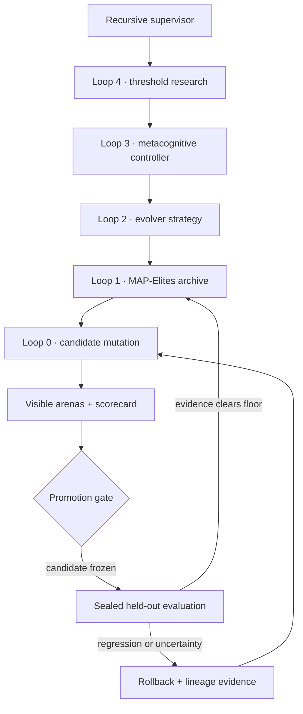
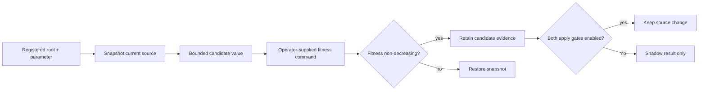

# Doofus

<div align="center">

**Evidence-driven metacognitive evolution for software and agent systems.**

Evolve aggressively. Measure honestly. Promote only against held-out proof.

[](https://github.com/ObtuseAI/doofus/actions/workflows/tests.yml)
[](https://github.com/ObtuseAI/doofus/actions/workflows/heldout-benchmarks.yml)
[](https://www.python.org/)
[](LICENSE)

</div>


Doofus is a local-first research platform for evolving optimizers, prompts, policies, and bounded project parameters while keeping promotion tied to reproducible evidence. It combines quality-diversity search, nested meta-loops, calibrated control, sealed held-out benchmarks, rollback, and a live evidence dashboard.

It does not treat a higher training score as proof of general improvement.

## What makes it different

| Capability | What it does |
| --- | --- |
| **Quality-diversity archive** | Preserves distinct strong candidates instead of collapsing everything into one brittle champion |
| **Nested evolution loops** | Evolves candidates, populations, evolution strategy, metacognitive control, and selected thresholds at separate cadences |
| **Held-out benchmark suite** | Freezes a candidate before a sealed one-shot evaluation the evolution loop never sees |
| **Calibrated metacognition** | Predicts outcome, effort, and risk; scores those predictions after the cycle; remains shadow-only until its gates pass |
| **External project evolution** | Tunes explicitly registered numeric parameters inside bounded project roots with fitness commands and rollback |
| **Proof-bearing operations** | Records lineage, scorecards, promotion decisions, health, cost, recovery, and best-known state |

## Nested-loop architecture



The loops share evidence, not unrestricted authority. The metacognitive subsystem starts in `shadow` mode: it records predictions and is scored after each cycle without changing runtime decisions.

## External project evolution

Doofus can optimize an explicitly registered parameter in another codebase:

```powershell
python scripts\doofus_register_project.py --add `
  --id my-project `
  --root C:\path\to\project `
  --fitness "python -m pytest -q" `
  --target "src\config.py:THRESHOLD:bounded tuning threshold"

python scripts\doofus_register_project.py --enable my-project
python scripts\doofus_evolve_project.py my-project --generations 10
```

Source mutation is off by default. Applying a candidate requires both the project-level `auto_apply` decision and the process-level `DOOFUS_CODEEVOLVE_AUTO_APPLY=1` gate. Regressions roll back to the prior content.



## Held-out evidence

The benchmark runner separates visible optimization objectives from sealed evaluation:

```powershell
python -m doofus.benchmarks --out heldout-report.json --engine-ref local
python scripts\doofus_evolution_vs_baseline.py --generations 24
```

The candidate is hashed and frozen before the held-out suite is opened. The report captures the baseline, candidate identity, visible and held-out scores, uncertainty, and promotion verdict. Pull requests run the slower benchmark only when labeled `run-heldout` or when the workflow is started manually.

See [the benchmark protocol](docs/benchmarks/HELDOUT_BENCHMARKS.md).

## Quick start

Requirements: Windows, Python 3.11+, and PowerShell.

```powershell
git clone https://github.com/ObtuseAI/doofus.git
cd doofus
python -m venv .venv
.\.venv\Scripts\python.exe -m pip install --upgrade pip
.\.venv\Scripts\python.exe -m pip install -e ".[dev]"
.\.venv\Scripts\python.exe -m pytest tests -q
```

Launch the local dashboard:

```powershell
.\.venv\Scripts\python.exe -m doofus.dashboard.doofus_dashboard_app
```

The runtime remains dry and provider-free when no API credentials are configured.

## Safety model

- **Measure first.** Self-modifying and external-project lanes are shadow-only until their independent gates are enabled.
- **Bound the target.** External paths must remain inside a declared root; protected roots and the Doofus workspace are rejected.
- **Strip secrets.** Fitness subprocesses do not inherit provider keys or `DOOFUS_*` control variables.
- **Cap spend and calls.** Runtime profiles carry explicit call, cost, and pressure ceilings.
- **Preserve recovery.** Snapshots, health checks, lineage, failover, and rollback remain part of the promotion contract.
- **Keep evidence honest.** Training improvement, internal arena scores, and backtests are not presented as proven general or real-world performance.

## Repository map

```text
doofus/                  evolution, metacognition, benchmarks, dashboard, runtime
config/                  reviewed public examples and bounded policy
scripts/                 setup, experiments, validation, and operator controls
tests/                   clean-clone behavioral and safety proof
docs/                    benchmark protocol, operating model, and research notes
runtime/                 machine-local state, metrics, controls, and recovery
```

Start with:

- [External project guide](docs/EXTERNAL_PROJECTS.md)
- [Metacognitive evolution](docs/DOOFUS_METACOGNITIVE_EVOLUTION.md)
- [24/7 autonomy policy](docs/DOOFUS_24_7_AUTONOMY_POLICY.md)
- [Safety boundary](docs/DOOFUS_SAFETY_BOUNDARY.md)
- [Contributing](CONTRIBUTING.md)
- [Security policy](SECURITY.md)

## Scope and limitations

Doofus is experimental software. A passing benchmark demonstrates performance on the checked tasks and seed policy only. It is not proof of general intelligence, production fitness, financial return, or safety outside the tested boundary. Live provider and external-project operation can incur cost or modify source when separately enabled; review configuration and use isolated repositories.

## License

[MIT](LICENSE) © 2026 Chris Harris.
