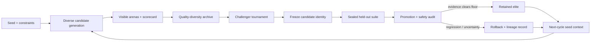
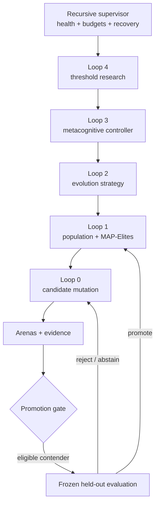
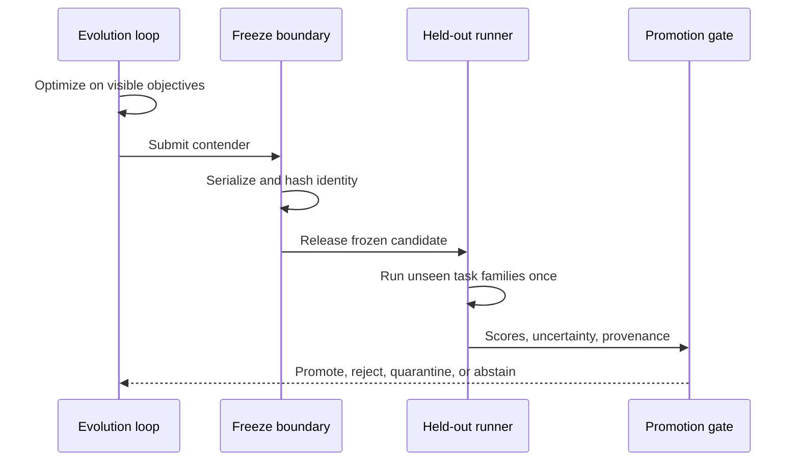
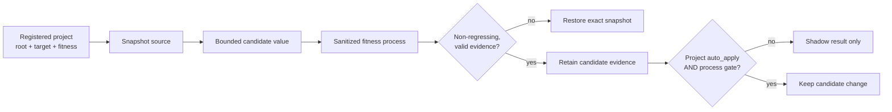

# Doofus

<div align="center">

**An evidence-driven laboratory for systems that learn how to improve.**

Generate diverse candidates. Measure the visible objective.<br>
Freeze the contender. Promote only when held-out evidence survives.

[](https://github.com/ObtuseAI/doofus/actions/workflows/tests.yml)
[](https://github.com/ObtuseAI/doofus/actions/workflows/heldout-benchmarks.yml)
[](https://www.python.org/)
[](doofus/evolution/map_elites_archive.py)
[](LICENSE)

</div>


Doofus is a local-first research platform for evolving optimizers, prompts, policies, mutation strategies, and explicitly registered project parameters.

It combines quality-diversity search, nested meta-evolution, calibrated metacognition, sealed held-out benchmarks, proof construction, runtime health, lineage, rollback, and an information-dense evidence dashboard.

The name is playful. The research question is not:

> How do you let a system change itself aggressively without mistaking activity, a higher training score, or a lucky run for improvement?

Doofus answers with diversity before convergence, predictions before outcomes, held-out evidence before promotion, and recovery as part of the experiment rather than an afterthought.

## Doofus in one minute

| Question | Answer |
| --- | --- |
| **What is it?** | A metacognitive evolution runtime and research workbench for measurable, reversible improvement. |
| **What can it evolve?** | Candidate configurations, optimization strategies, prompts, bounded genes, and declared numeric parameters in external projects. |
| **How does it search?** | Mutation, novelty pressure, challenger tournaments, MAP-Elites archives, shadow elites, and higher-order strategy loops. |
| **How does it avoid fooling itself?** | Candidate freezing, held-out tasks, calibration scoring, lineage, proof density, repeatability, uncertainty, and rollback. |
| **What does it show?** | Candidates, archives, scores, costs, safety events, metacognitive predictions, promotion audits, runtime health, and recovery state. |
| **Does it need an API key?** | No for local tests, benchmarks, dashboards, and provider-free runs. Provider lanes are optional and separately configured. |

## Why evolution systems need an evidence architecture

A naive optimizer follows one signal:

```text
mutate -> score -> keep the highest score -> repeat
```

That loop is vulnerable to:

- overfitting the visible objective;
- converging on one brittle champion;
- exploiting scoring bugs;
- mistaking noise for progress;
- choosing costly strategies for marginal gains;
- forgetting why a candidate exists;
- promoting a candidate that cannot be replayed;
- corrupting the source or runtime when a trial regresses;
- allowing the controller to trust its own confidence without calibration.

Doofus expands the loop:



Visible performance can earn a candidate the right to be tested. It cannot earn promotion by itself.

## The five nested learning loops

Doofus treats “the thing being optimized” and “the way optimization happens” as different evolutionary layers.



| Loop | What changes | What measures it | Default authority |
| --- | --- | --- | --- |
| **0. Candidate** | A value, prompt, trait, policy fragment, or bounded source parameter. | Task fitness, correctness, cost, safety, and candidate scorecard. | Trial only. |
| **1. Population** | Parent choice, niches, novelty, archive membership, and challenger selection. | Diversity, coverage, stability, and elite quality. | Archive management. |
| **2. Strategy** | Mutation pressure, algorithm selection, stagnation response, and compounding policy. | Improvement rate, regressions, cost, replay, and tournament outcomes. | Strategy proposal or bounded runtime policy. |
| **3. Metacognition** | Confidence, predicted outcome, resource allocation, abstention, and strategy selection. | Calibration error and post-cycle outcome. | `shadow` until independent gates pass. |
| **4. Threshold research** | Candidate promotion, proof-density, pressure, and control thresholds. | Historical counterfactuals and bounded sweeps. | Recommendation; no silent gate weakening. |

The loops share evidence. They do not share unrestricted authority.

## Capability atlas

### 1. Quality-diversity search

The MAP-Elites and elite-archive surfaces preserve different kinds of good candidates rather than collapsing all progress into a single scalar leader.

Doofus tracks:

- behavior or trait niches;
- candidate and parent identity;
- mutation lineage;
- novelty pressure;
- elite, shadow-elite, and challenger states;
- archive growth and retirement;
- best-ever records;
- next-cycle seed context;
- upgrade and retest queues.

This matters when two candidates have similar average fitness but meaningfully different cost, risk, stability, or behavior. Diversity keeps the system from forgetting the safer or more transferable option.

### 2. Metacognitive control

Before a cycle, the metacognitive subsystem can record:

- expected outcome;
- confidence;
- predicted difficulty;
- resource and effort estimates;
- known uncertainty;
- strategy selection;
- abstention or escalation recommendation.

After the cycle, those predictions are compared with observed outcomes. Calibration, not rhetorical confidence, determines whether the controller is learning to predict its own performance.

The subsystem begins in `shadow` mode. Shadow mode means it records what it would have done and receives a score, but does not control the runtime decision. Promotion requires sustained, independently measured calibration and safety evidence.

### 3. Candidate scoring and promotion

Promotion is assembled from multiple evidence surfaces:

| Evidence surface | Question |
| --- | --- |
| **Candidate scorecard** | Did the candidate improve the named objective and preserve required constraints? |
| **Arena support** | Was it tested across the required contexts rather than one convenient case? |
| **Proof density** | Is there enough current, attributable evidence for the strength of the claim? |
| **Replay audit** | Can the result be reproduced from retained identity and inputs? |
| **Regression audit** | Did any protected metric or behavior degrade? |
| **Safety audit** | Did the trial remain inside path, budget, provider, and mutation boundaries? |
| **Bloat audit** | Did complexity or operating cost expand without justified value? |
| **Near-miss analysis** | Why did an otherwise strong candidate fail the final gate? |
| **Quarantine** | Is uncertainty material enough to remove the candidate from promotion? |

A high raw score can still be rejected for weak proof, instability, safety findings, or held-out regression.

### 4. Sealed held-out benchmarks

Doofus includes a versioned held-out suite across three task families:

- **optimization** — candidate behavior on objective landscapes not exposed to the visible loop;
- **code repair** — bounded source-repair tasks evaluated through executable behavior;
- **calibration** — confidence and prediction quality against known outcomes.

The candidate is serialized and hashed before the held-out tasks are evaluated. The report records:

- suite version and engine reference;
- frozen candidate identity;
- per-task score and details;
- task-family aggregates;
- weighted suite score;
- uncertainty and promotion verdict.



The slower held-out workflow is opt-in on pull requests through the `run-heldout` label and can also be started manually. This keeps routine CI fast while making benchmark promotion an explicit act.

See the [held-out benchmark protocol](docs/benchmarks/HELDOUT_BENCHMARKS.md).

### 5. External project evolution

Doofus can tune an explicitly registered numeric parameter in another repository.

The contract requires:

- a named project and absolute root;
- a declared fitness command;
- an exact source file and parameter;
- a bounded numeric search space;
- source snapshot before mutation;
- isolated fitness execution with a sanitized environment;
- comparison against the previous accepted score;
- rollback on regression or failure;
- separate project and process gates before a change can remain applied.



The Doofus workspace, protected roots, and any path outside the registered project root are rejected.

### 6. Proof builder

Promising candidates often fail promotion because their evidence is incomplete rather than because their behavior is poor. The proof-builder lane makes that distinction visible.

It can:

- identify high-scoring rejected candidates;
- classify missing replay, stability, arena, lineage, or density evidence;
- queue bounded proof work;
- build replay and score-stability artifacts;
- track rescue budgets;
- report whether additional evidence changed the verdict;
- avoid changing the candidate while proof is being constructed.

This turns “almost passed” into a specific research question instead of an excuse to lower the threshold.

### 7. Runtime, health, and recovery

Always-on research introduces a second optimization target: operational reliability.

Doofus includes:

- heartbeats and process identity;
- duplicate-process detection;
- runtime and dashboard supervisors;
- on/off and emergency-stop controls;
- checkpoints and atomic JSON state;
- metrics-database failover;
- stale-state and contamination detection;
- baseline certification;
- capped calls, spend, pressure, and run windows;
- watchdog evidence and recovery reports.

Recovery state is part of the promotion story. A candidate is not operationally better if reaching it makes the system unrecoverable.

### 8. Evidence dashboard

The NiceGUI dashboard is a live research observatory rather than a decorative status page.

It brings together:

- current candidate and best-known state;
- MAP-Elites and shadow-elite archive growth;
- lineage and mutation variants;
- visible, held-out, proof-density, and promotion scores;
- metacognitive predictions and calibration;
- model/provider usage and cost;
- safety, budget, and quarantine events;
- proof-builder queues and rescue outcomes;
- supervisor, watchdog, checkpoint, and failover health;
- promotion audits and full-run reports.

The dashboard reads evidence produced by the runtime. A chart does not become a gate merely because it is visible.

## A concrete project experiment

Suppose a project exposes a bounded `THRESHOLD` constant and a reproducible test command.

### 1. Register the project

```powershell
python scripts\doofus_register_project.py --add `
  --id my-project `
  --root C:\path\to\project `
  --fitness "python -m pytest -q" `
  --target "src\config.py:THRESHOLD:bounded tuning threshold"
```

### 2. Measure before mutation

```powershell
python scripts\doofus_register_project.py --measure my-project
```

The baseline establishes whether the fitness command is valid and stable enough to support an experiment.

### 3. Enable and evolve

```powershell
python scripts\doofus_register_project.py --enable my-project
python scripts\doofus_evolve_project.py my-project --generations 10
```

By default, results remain shadow evidence. To retain a source mutation, both the reviewed project configuration and the process-level `DOOFUS_CODEEVOLVE_AUTO_APPLY=1` gate must be present. A failed or regressing fitness run restores the snapshot.

### 4. Inspect the result

Review candidate lineage, parameter values, measured scores, subprocess evidence, rollback state, and whether either apply gate remained closed.

This is bounded parameter research, not permission for arbitrary code rewriting.

## Quick start

Requirements: Windows, Python 3.11+, and PowerShell.

```powershell
git clone https://github.com/ObtuseAI/doofus.git
cd doofus
python -m venv .venv
.\.venv\Scripts\python.exe -m pip install --upgrade pip
.\.venv\Scripts\python.exe -m pip install -e ".[dev]"
.\.venv\Scripts\python.exe -m pytest tests -q
```

Run the held-out baseline:

```powershell
.\.venv\Scripts\python.exe -m doofus.benchmarks `
  --engine-ref local `
  --out heldout-report.json
```

Launch the local evidence dashboard:

```powershell
.\.venv\Scripts\python.exe -m doofus.dashboard.doofus_dashboard_app
```

The test suite, benchmark runner, and dashboard work without provider credentials. The runtime remains dry and provider-free when no optional provider is configured.

Optional research extras expose quality-diversity and agent-evolution integrations:

```powershell
.\.venv\Scripts\python.exe -m pip install -e ".[sota]"
```

Review provider, cost, secret, and runtime policies before enabling any live model lane.

## Safety model

| Boundary | Enforcement |
| --- | --- |
| **Mutation** | Shadow by default; explicit project and process gates for external source retention. |
| **Filesystem** | Registered roots, protected-root rejection, exact target registry, snapshot and rollback. |
| **Subprocesses** | Operator-supplied fitness commands run with provider secrets and `DOOFUS_*` controls removed. |
| **Providers** | Optional adapters, explicit secret sources, response validation, call ledger, cost and call ceilings. |
| **Promotion** | Score, proof density, replay, regression, safety, bloat, and held-out evidence remain separate checks. |
| **Metacognition** | Prediction and recommendation in shadow mode until calibration and safety gates justify more. |
| **Runtime** | Heartbeats, duplicate-process checks, watchdogs, checkpoints, emergency stop, and failover. |
| **Claims** | Internal, visible, held-out, simulated, backtested, and live evidence remain differently labeled. |

## Release proof

The public workflows separate routine correctness from expensive benchmark evidence:

| Workflow | Trigger | What it proves |
| --- | --- | --- |
| **Tests / pytest** | Push and pull request | Installs the package on Windows and runs the clean-checkout suite without API keys. |
| **Tests / Ruff** | Push and pull request | Blocks on the repository’s selected Python error and correctness rules. |
| **Held-out benchmarks** | Manual or `run-heldout` pull-request label | Reproduces the committed baseline, runs the sealed suite, and uploads the exact report for the source SHA. |
| **Public release readiness** | Inside the test job | Checks presentation, links, license, hygiene, and public-source constraints. |

Routine CI intentionally does not claim a long-running local evolution history exists on a fresh runner. Machine-local live-runtime tests are marked and isolated from clean-clone proof.

## Repository map

```text
doofus/
|-- evolution/             candidates, archives, novelty, tournaments, lineage
|-- metacognition/         predictions, calibration, memory, abstention, control
|-- meta/                  strategy, prompt, gene, and external-project evolution
|-- benchmarks/            frozen held-out runner and task families
|-- scoring/               scorecards, proof density, promotion and quarantine
|-- proof/                 replay, stability, lineage, and rescue evidence
|-- runtime/               health, failover, process identity, recovery
|-- supervisor/            always-on coordination and watchdogs
|-- dashboard/             live research observatory
|-- model_router/          optional provider policies, validation, and ledgers
|-- safety/                budgets, switches, and secret boundaries
config/                    reviewed runtime and evolution policy
scripts/                   setup, experiments, validation, and operator controls
tests/                     clean-clone behavior and safety proof
docs/                      benchmark, operation, dashboard, and research guides
runtime/                   machine-local state, metrics, controls, and recovery
```

Recommended reading:

1. [Metacognitive evolution](docs/DOOFUS_METACOGNITIVE_EVOLUTION.md) — runtime modes, evidence loop, and authority.
2. [Held-out benchmark protocol](docs/benchmarks/HELDOUT_BENCHMARKS.md) — task inventory and isolation.
3. [External project guide](docs/EXTERNAL_PROJECTS.md) — fitness contracts and bounded source experiments.
4. [Safety boundary](docs/DOOFUS_SAFETY_BOUNDARY.md) — mutation, providers, budgets, and recovery.
5. [24/7 autonomy policy](docs/DOOFUS_24_7_AUTONOMY_POLICY.md) — unattended-runtime constraints.
6. [Dashboard guide](docs/DOOFUS_DASHBOARD.md) — observability surfaces.
7. [Security policy](SECURITY.md) and [contribution guide](CONTRIBUTING.md).

## Who this is for

Doofus is useful to:

- researchers studying evolutionary optimization and quality diversity;
- agent engineers evaluating prompt, policy, or strategy adaptation;
- developers who need reversible tuning against an executable fitness command;
- teams exploring calibrated metacognition rather than self-reported confidence;
- operators who want a visible promotion and recovery trail for long-running experiments.

## Scope and limitations

Doofus is experimental software.

A passing benchmark establishes performance only on the named tasks, suite version, seed policy, candidate identity, and environment represented in the report. It is not proof of general intelligence, universal optimization, production fitness, safety outside the tested boundary, or financial return.

Live provider and external-project modes can incur cost or modify source when separately enabled. Use isolated repositories, review every target and fitness command, protect credentials, and preserve recovery artifacts.

Doofus does not:

- guarantee that a fitness function measures what you intended;
- make a held-out suite immune to all forms of leakage;
- turn internal score growth into real-world improvement;
- remove the need for operator judgment;
- authorize arbitrary self-modification;
- promise that a long-running research process will discover a better candidate.

Sometimes the honest outcome is no promotion.

## Citation and license

Citation metadata is available in [`CITATION.cff`](CITATION.cff).

[MIT](LICENSE) © 2026 Chris Harris.
