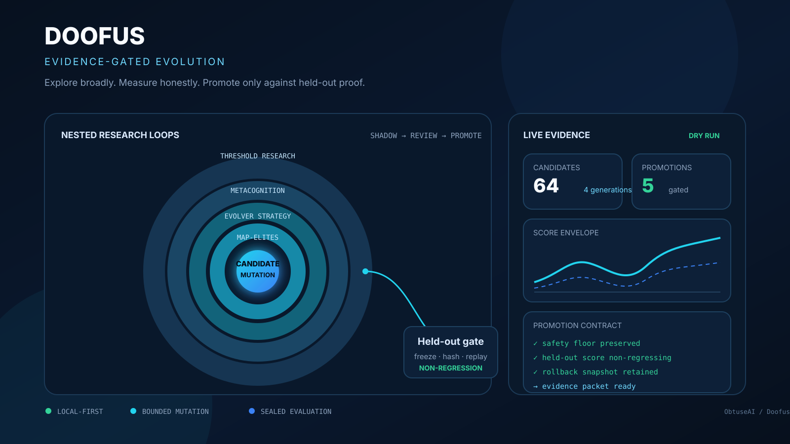
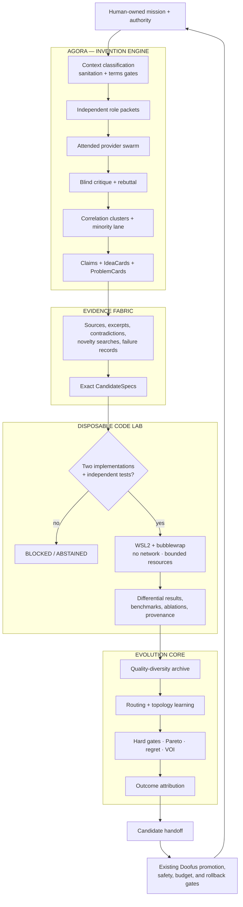
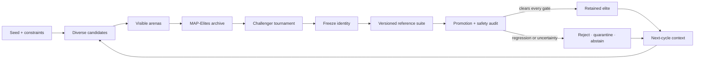

# Doofus

<div align="center">

**The evidence-gated invention and evolution laboratory.**

Turn diverse machine proposals into attributable claims, adversarial debate,<br>
sandboxed experiments, calibrated decisions, and reversible candidate handoffs.

[](https://github.com/ObtuseAI/doofus/actions/workflows/tests.yml)
[](https://github.com/ObtuseAI/doofus/actions/workflows/heldout-benchmarks.yml)
[](CHANGELOG.md)
[](https://www.python.org/)
[](#agora-frontier)
[](#authority-ceiling)
[](LICENSE)

[See the architecture](#system-architecture) ·
[Enter Agora](#agora-frontier) ·
[Run locally](#quick-start) ·
[Inspect the proof model](#the-evidence-constitution)

</div>



## The frontier is not more output. It is better evidence.

Modern AI systems can generate an astonishing number of ideas. The harder problem is deciding which ideas are actually different, which claims are supported, which failures are informative, which experiments are decisive, and which candidate—if any—has earned the right to move forward.

Doofus is a local-first research platform for that problem. It combines an attended multi-model invention swarm with quality-diversity evolution, calibrated metacognition, evidence adjudication, disposable code experiments, lineage, replay, promotion gates, rollback, and a dense operator console.

The name is playful. The operating question is not:

> How quickly can a system produce and promote its own answer?

It is:

> How aggressively can a system explore while making every consequential transition inspectable, bounded, falsifiable, and reversible?

Doofus answers with divergence before convergence, mechanisms before rhetoric, predictions before outcomes, experiments before reusable genes, and human-owned authority at the final boundary.

## Product truth

| Contract | Current public state |
| --- | --- |
| **Product** | **Doofus v1.2 — Evolution, Metacognition, and Agora Invention Lab** |
| **Maturity** | **Research preview** |
| **Primary role** | Generate, challenge, verify, test, and rank bounded candidate mechanisms without silently promoting them. |
| **Proved in source** | Frozen Agora contracts, attended provider exchange, blind critique, minority preservation, content-addressed evidence, MAP-Elites archives, candidate freezing, replay, sandboxed experiments, calibrated metacognition, promotion audits, rollback, and bounded external-project trials. |
| **Evidence baseline** | Provider-free Windows CI, Ruff, public-release hygiene checks, an opt-in versioned reference suite, and dedicated Agora policy/evidence/sandbox/integration coverage. |
| **Authority ceiling** | Agora produces proposals and candidate handoffs. Existing Doofus gates and the human operator retain promotion, source mutation, provider, budget, and execution authority. |
| **Known limit** | The committed reference tasks are public—not a secret or independently administered holdout. Passing them does not establish general intelligence, production fitness, or real-world improvement. |

## Doofus at a glance

| Surface | Public v1.2 contract |
| --- | --- |
| **10 provider nodes** | Six enabled core perspectives and four measured reserve nodes; consumer-browser automation is disabled. |
| **Attended by design** | Prompts leave and responses return through explicit local clipboard/file workflows. Imported text is inert and untrusted. |
| **One constitutional ledger** | Mission transitions and governance events are appended to an isolated SQLite hash chain. |
| **One content-addressed vault** | Prompts, responses, source captures, reports, and receipts are bound to SHA-256 identities. |
| **No majority shortcut** | Blind critique, correlation groups, falsification, and a protected minority lane replace chatbot voting. |
| **Two implementations required** | Candidate code needs independently sourced implementations plus tests from another provider or role before execution. |
| **Five nested learning loops** | Candidate, population, strategy, metacognition, and threshold research evolve under separate evidence and authority boundaries. |
| **Zero direct promotion authority** | `ACT` means “eligible for submission to existing Doofus gates,” never “apply this change.” |

## System architecture

Doofus v1.2 joins two engines under one evidence constitution:

- **Agora** discovers, debates, verifies, formalizes, and experimentally tests mechanisms.
- **Evolution Core** searches candidate space, preserves behavioral diversity, measures outcomes, and controls promotion.



No arrow in this architecture bypasses the operator or the existing Doofus gates.

## Agora Frontier

Agora is the v1.2 attended invention and debate subsystem. It is built for missions where one fluent answer is less valuable than a diverse set of mechanisms that can survive criticism, evidence review, and an executable test.

### The mission journey

```text
DRAFT → SANITIZED → PACKETS_READY → COLLECTING → DEBATING
      → VERIFYING → FORMALIZED → EXPERIMENT_READY → EXPERIMENTED
      → DECIDED → ATTRIBUTED
```

`BLOCKED`, `ABSTAINED`, and `ARCHIVED` are honest terminal states. A mission cannot skip forward through missing evidence, unavailable terms, malformed responses, unverified dependencies, or failed sandbox gates.

| Stage | What becomes true |
| --- | --- |
| **DRAFT** | The decision, context, constraints, falsifiers, tests, and baseline exist as a frozen mission contract. |
| **SANITIZED** | Export policy has classified the context and produced the required receipt and approval. |
| **PACKETS_READY** | Independently ordered role packets contain verified facts, open questions, constraints, falsifiers, and response schemas. |
| **COLLECTING** | The operator is conducting the attended prompt/response exchange. |
| **DEBATING** | Proposals are anonymized, clustered, challenged, steelmanned, rebutted, and adversarially falsified. |
| **VERIFYING** | Claims and novelty assertions are assessed against attributable sources or empirical results. |
| **FORMALIZED** | Surviving mechanisms become IdeaCards and exact CandidateSpecs. |
| **EXPERIMENT_READY** | Independence, dependency, provenance, test, and baseline requirements are satisfied. |
| **EXPERIMENTED** | The disposable laboratory has produced bounded receipts and measurements. |
| **DECIDED** | Hard gates, Pareto structure, pairwise evidence, scenarios, regret, VOI, calibration, and minority review are recorded. |
| **ATTRIBUTED** | Measured outcomes update routing, topology, prompt attribution, stop behavior, and eligible learning surfaces. |

### Provider constellation

Provider names describe operator-selected consumer surfaces; they do not imply affiliation or automated access.

| Lane | Nodes | Starting mode | Automation |
| --- | --- | --- | --- |
| **Core reasoning and synthesis** | ChatGPT, Claude | `ATTENDED` | Disabled |
| **Core evidence and retrieval perspective** | Perplexity | `ATTENDED` | Disabled |
| **Core alternate model families** | DeepSeek, Qwen | `ATTENDED` | Disabled |
| **Core open-model diversity** | HuggingChat | `ASSISTED` | Local clipboard/file staging only |
| **Measured reserve** | Gemini, Microsoft Copilot, Le Chat, Grok | `ATTENDED` | Disabled |

Execution mode and terms status are deliberately separate. Availability, quota, cooldown, measured capabilities, correlation groups, and historical outcomes are dynamic routing inputs—not permission to automate a provider.

`AUTONOMOUS_ALLOWED` and `API_OPTIONAL` exist as contracts, but the generic attended adapter refuses them unless a separately registered adapter, current provider-specific terms decision, explicit operator approval, permitted operations, and existing Doofus budget gates all pass.

### Privacy before intelligence

Every mission requires an explicit context class:

| Context | Export rule |
| --- | --- |
| `PUBLIC` | Allowed only after policy scanning confirms the payload matches the declared class. |
| `SANITIZED_INTERNAL` | Requires a sanitation receipt and explicit operator approval. |
| `SECRET` | Never exportable. Missing classification fails closed as `SECRET`. |

The scanner looks for credentials, API keys, personal data, private addresses, non-public source material, proprietary datasets, security findings, and governance instructions. Imported provider responses are always treated as inert, untrusted content. Parsing may extract fields and code blocks; it cannot execute instructions or modify the repository.

### Debate without a popularity contest

Agora does not count votes.

It uses:

- reproducible, correlation-aware contextual Thompson routing;
- mission-scoped anonymous proposal identities;
- balanced steelman and hostile-critique assignments;
- explicit self-review prevention;
- divergence, blind critique, rebuttal, falsification, and synthesis rounds;
- correlation clustering so repeated mechanisms do not masquerade as independent support;
- a protected lane for at least one supported, mechanistically distinct minority candidate;
- information-gain and value-of-information stopping rules.

The stop controller can halt when no new mechanism appears, contradictions stop shrinking, a decisive experiment is available, quota or hard gates are exhausted, or expected value turns negative.

### Evidence that can say “not enough”

The `EvidenceFabric` interface ships with a keyless implementation for bounded public HTTPS retrieval, GitHub repository metadata/search, and Crossref/OpenAlex paper metadata.

Every claim receives one of five states:

| State | Meaning |
| --- | --- |
| `SUPPORTED` | An attributable excerpt, independent assessment, or empirical result supports the claim. |
| `CONTRADICTED` | Recorded evidence conflicts with the claim. |
| `UNVERIFIED` | Sources may exist, but the required support has not been established. |
| `MISSING` | Required evidence was not found or supplied. |
| `AMBIGUOUS` | Available evidence does not resolve the claim. |

Source existence alone never upgrades a claim. `POSSIBLY_NOVEL_MECHANISM` is unavailable until recorded repository and literature searches complete. Retrieval failures remain explicit rather than triggering silent evidence substitution.

The public retriever blocks private and reserved addresses, credential-bearing URLs, unsafe redirects, disallowed content types, and oversized bodies. It revalidates DNS and the connected peer, enforces TLS and timeouts, limits retries and response size, and hashes every retained object.

### From mechanism to executable candidate

Surviving ideas become exact `CandidateSpec` contracts containing:

- interfaces and invariants;
- pseudocode and complexity;
- dependencies and licenses;
- failure modes;
- contract and property scenarios;
- a frozen positive benchmark baseline;
- ablations and falsification criteria;
- provenance for implementations and tests.

The WSL2 `bubblewrap` laboratory provides isolated namespaces, no network, no host-repository mount, a read-only root and input mount, one bounded output directory, a cleared environment, and CPU, memory, process, file, output, and wall-time limits.

Standard-library experiments are allowed by default. External packages remain `BLOCKED_UNVERIFIED_DEPENDENCY` until exact name, version, hash, license, and operator-approved offline wheelhouse records exist.

Successful experiments produce candidate handoffs. They are never applied to the primary repository.

### Decision intelligence

Candidate choice combines:

- hard safety and evidence gates;
- Pareto dominance rather than one blended score;
- blind pairwise evidence;
- scenario performance and calibration;
- expected regret;
- value of information;
- minority-candidate review;
- measured experiment receipts.

The available actions are `ACT`, `BUILD_PROTOTYPE`, `RUN_EXPERIMENT`, `DEFER`, `REJECT`, and `ABSTAIN`. In every case, Agora’s authority effect is explicit.

### Problem Foundry and coevolution

The Problem Foundry converts rejected candidates, quality-diversity gaps, runtime failures, proof debt, bottlenecks, and unresolved decisions into frozen `ProblemCard` contracts.

It preserves a diverse portfolio across problem category and launches problem-solution tournaments that can:

- propose mechanisms;
- request evidence;
- define decisive experiments;
- expose unresolved proof debt;
- generate bounded candidate handoffs.

It cannot write to another project, weaken a gate, or create a reusable gene from persuasive prose. GEP capsules require experimentally validated, fully accepted mechanisms.

## Evolution Core

Agora expands the candidate frontier. The Evolution Core determines how that frontier is searched, measured, remembered, and challenged.

### Five nested learning loops

| Loop | What changes | What measures it | Default authority |
| --- | --- | --- | --- |
| **0. Candidate** | A value, prompt, trait, policy fragment, or bounded mechanism. | Correctness, task fitness, cost, safety, and candidate scorecard. | Trial only. |
| **1. Population** | Parent choice, niches, novelty, archive membership, and challengers. | Diversity, coverage, stability, and elite quality. | Archive management. |
| **2. Strategy** | Mutation pressure, routing, topology, stagnation response, and compounding policy. | Improvement rate, regressions, cost, replay, and tournament outcomes. | Strategy proposal or bounded runtime policy. |
| **3. Metacognition** | Confidence, predicted outcome, effort, abstention, and strategy selection. | Calibration error and post-cycle outcome. | Shadow until independently cleared. |
| **4. Threshold research** | Promotion, proof-density, pressure, and control thresholds. | Historical counterfactuals and bounded sweeps. | Recommendation; no silent gate weakening. |



Visible performance can earn the right to be tested. It cannot earn promotion by itself.

### Quality diversity over one brittle champion

MAP-Elites and shadow-elite archives retain behaviorally different candidates across mechanism, novelty, domain, risk, cost, complexity, and evidence strength.

That preserves options when two candidates have similar average fitness but meaningfully different safety, stability, transfer, or operating cost. Challenger tournaments, novelty pressure, lineage, retirement, and retest queues keep the archive dynamic without erasing the safer minority.

### Metacognition measured after the fact

Before a cycle, the controller records expected outcome, confidence, difficulty, resource estimate, uncertainty, and preferred strategy. After the cycle, the prediction is compared with what happened.

Calibration—not rhetorical confidence—determines whether the controller is getting better at predicting its own performance. Higher-authority metacognitive behavior remains shadowed until independent evidence supports promotion.

### Bounded external-project evolution

Doofus can tune an explicitly registered numeric parameter in another repository. The contract requires:

- a named project and absolute root;
- an operator-declared fitness command;
- one exact source file and parameter;
- a bounded numeric search space;
- a snapshot before mutation;
- isolated fitness execution with a sanitized environment;
- comparison against the accepted baseline;
- exact rollback on regression or failure;
- separate project and process gates before retention.

The Doofus workspace, protected roots, and paths outside the registered project are rejected. By default, the result remains shadow evidence. See the [external-project guide](docs/EXTERNAL_PROJECTS.md).

## The evidence constitution

Every impressive result is weaker than the boundary that produced it. Doofus keeps evidence surfaces separate so one kind of success cannot impersonate another.

| Evidence surface | The question it answers |
| --- | --- |
| **Mission contract** | Was the decision, context, success condition, baseline, and falsifier declared before collection? |
| **Candidate scorecard** | Did the candidate improve the named objective without breaking required constraints? |
| **Arena support** | Was it exercised across the required contexts rather than one convenient case? |
| **Claim evidence** | Is the assertion tied to an attributable excerpt, independent assessment, or empirical result? |
| **Novelty search** | Were repository and literature searches actually recorded? |
| **Proof density** | Is there enough current evidence for the strength of the claim? |
| **Replay audit** | Can the result be reproduced from retained identity, configuration, and inputs? |
| **Regression audit** | Did a protected metric or behavior degrade? |
| **Safety audit** | Did the trial stay inside path, budget, provider, dependency, and mutation boundaries? |
| **Bloat audit** | Did complexity or operating cost expand without corresponding value? |
| **Minority review** | Did a correlated majority erase a supported distinct mechanism? |
| **Outcome attribution** | Which provider, prompt, topology, critique, experiment, and decision actually contributed? |

Sometimes the correct result is `UNVERIFIED`. Sometimes it is `BLOCKED`. Sometimes no candidate should be promoted.

## Operator console

The NiceGUI dashboard is a local research observatory rather than a decorative status page.

The scoped Agora surface adds:

- mission composition and sanitation preview;
- provider availability, terms, quota, and cooldown matrix;
- attended packet inbox;
- debate topology and blind identity graph;
- evidence matrix and source failures;
- protected minority lane;
- CandidateSpec and decision comparison;
- experiment and sandbox receipts;
- quality-diversity archive;
- Problem Foundry portfolio;
- attribution history.

The broader dashboard continues to expose candidate state, MAP-Elites growth, lineage, visible and reference-suite scores, calibration, model cost, safety events, proof-builder queues, watchdog health, checkpoints, failover, and promotion audits.

The interface uses a dense asymmetric bento layout with semantic status colors, visible keyboard focus, responsive breakpoints, short feedback transitions, and reduced-motion support. A chart can explain a gate; it cannot become one.

## Quick start

Requirements: Windows, Python 3.11+, PowerShell, and [`uv`](https://docs.astral.sh/uv/).

```powershell
git clone https://github.com/ObtuseAI/doofus.git
cd doofus
uv venv --python 3.11 .venv
uv pip install --python .venv\Scripts\python.exe -e ".[dev]"
```

Run provider-free correctness and the public versioned reference suite:

```powershell
.\.venv\Scripts\python.exe -m pytest tests -q
.\.venv\Scripts\python.exe -m doofus.benchmarks `
  --engine-ref local `
  --out reference-suite-report.json
```

Launch the local evidence dashboard:

```powershell
.\.venv\Scripts\python.exe -m doofus.dashboard.doofus_dashboard_app
```

The test suite, benchmark runner, dashboard, and local Agora fixtures work without provider credentials.

## Run an attended Agora mission

Create `mission.yaml` outside the source tree.

<details>
<summary><strong>Open the complete reproducible mission contract</strong></summary>

```yaml
mission_type: invention
objective: Validate a deterministic identity mechanism against a declared latency baseline.
decision_to_inform: Whether to admit the mechanism to bounded experiments.
target_project: doofus
context: This mission contains public, non-sensitive context only.
context_class: PUBLIC
known_evidence:
  - The baseline and comparison metric are declared before collection.
hard_constraints:
  - Preserve every existing Doofus promotion and safety gate.
forbidden_actions:
  - No browser automation, repository mutation, credentials, or live execution.
success_metrics:
  - Independent implementations agree and beat the declared baseline.
falsification_conditions:
  - Any contract mismatch or sandbox boundary failure.
open_questions:
  - What is the cheapest decisive experiment?
candidate_test_cases:
  - input: {value: 0}
    expected: 0
  - input: {value: 1}
    expected: 1
  - input: {value: -1}
    expected: -1
benchmark_baseline_score: 10.0
maximum_nodes: 6
maximum_rounds: 3
topology_id: frontier_hexagon
```

</details>

Create the mission and export the first attended packets:

```powershell
.\.venv\Scripts\doofus-agora.exe mission-create --mission .\mission.yaml
.\.venv\Scripts\doofus-agora.exe provider-status
.\.venv\Scripts\doofus-agora.exe packet-export `
  --mission-id MSN_ID `
  --destination .\runtime\agora\outbox
```

Conduct the provider exchange yourself, save each answer as a local file, and import it:

```powershell
.\.venv\Scripts\doofus-agora.exe response-import `
  --packet-id PKT_ID `
  --response .\answer.md

.\.venv\Scripts\doofus-agora.exe round-advance --mission-id MSN_ID
.\.venv\Scripts\doofus-agora.exe evidence-verify --mission-id MSN_ID
```

After CandidateSpecs and independent implementation/test artifacts exist:

```powershell
.\.venv\Scripts\doofus-agora.exe sandbox-execute `
  --mission-id MSN_ID `
  --candidate-id CAN_ID `
  --implementation-a .\implementation-a.py `
  --implementation-b .\implementation-b.py `
  --provider-a chatgpt `
  --provider-b claude `
  --test-provider deepseek `
  --baseline-score 10

.\.venv\Scripts\doofus-agora.exe decision-build `
  --mission-id MSN_ID `
  --value-of-information 0.2

.\.venv\Scripts\doofus-agora.exe report-generate `
  --mission-id MSN_ID `
  --destination .\runtime\agora\reports
```

The same interface is available through `python -m doofus.agora`.

### Agora command surface

| Command | Purpose |
| --- | --- |
| `provider-status` | Inspect provider, execution-mode, terms, quota, cooldown, and mission state. |
| `mission-create` | Validate, classify, sanitize, and compile a mission into independent packets. |
| `mission-status` | Inspect the append-only state and retained mission contract. |
| `packet-export` | Write attended prompt packets to an explicit local destination. |
| `response-import` | Import a saved answer as inert, hashed content. |
| `round-advance` | Advance one fully collected debate round. |
| `evidence-verify` | Adjudicate claims and record repository/literature novelty searches. |
| `sandbox-execute` | Differentially execute independent implementations under the code-lab boundary. |
| `decision-build` | Apply hard gates, decision analysis, and optional measured learning attribution. |
| `terms-refresh` | Fetch and hash a provider terms source under bounded retrieval policy. |
| `terms-review` | Record an explicit operator decision and permitted operations. |
| `problem-foundry` | Build a diverse ProblemCard portfolio from declared observations and rejections. |
| `report-generate` | Emit Markdown, JSON, and a reproducibility capsule. |

Mission metadata lives in `runtime/agora/agora.sqlite`. Content-addressed objects live in `runtime/agora/vault`. Reports include configuration hashes, artifact hashes, the routing seed, evidence records, decision analysis, event-chain receipts, and experiment provenance.

## Safety and authority

### Authority ceiling

| Boundary | Enforcement |
| --- | --- |
| **Consumer providers** | Attended local exchange only. No click, submit, scrape, or response-extraction automation. |
| **Context export** | Explicit classification; missing context fails closed; `SECRET` never leaves the boundary. |
| **Imported text** | Inert and untrusted; no instruction execution or repository mutation. |
| **Terms** | URL, fetched-body hash, review time, decision, and permitted operations are recorded. Changed or unavailable terms block automation. |
| **Evidence** | Source existence is not support; failures and ambiguity remain explicit. |
| **Candidate code** | Disposable no-network sandbox; no primary-repository mount; bounded resources and output. |
| **Dependencies** | Standard library by default; external wheels require exact identity, hash, license, and approval. |
| **Mutation** | Shadow by default; external retention requires independent project and process gates. |
| **Promotion** | Score, replay, evidence, regression, safety, bloat, reference-suite, and minority review remain separate. |
| **Metacognition** | Prediction and recommendation remain shadowed until calibration and safety evidence justify more. |
| **Runtime** | Heartbeats, duplicate-process checks, watchdogs, checkpoints, emergency stop, and failover. |
| **Decision** | `ACT` can submit a candidate to existing gates. It cannot apply, merge, deploy, trade, or spend. |

Consumer-provider terms can change. The tracked registry begins with the [OpenAI Terms of Use](https://openai.com/policies/terms-of-use/) and [Anthropic Consumer Terms](https://www.anthropic.com/legal/consumer-terms), but operators must refresh and review every provider-specific source before considering a future adapter.

Read the [security policy](SECURITY.md), [safety boundary](docs/DOOFUS_SAFETY_BOUNDARY.md), and [secret/environment policy](docs/DOOFUS_SECRET_AND_ENVIRONMENT_POLICY.md) before enabling provider or mutation lanes.

## Reference-suite evaluation

Doofus includes a public, versioned suite across three families:

- **optimization** — objective-landscape behavior;
- **code repair** — bounded repairs evaluated through executable behavior;
- **calibration** — prediction quality against known outcomes.

The contender is serialized and hashed before evaluation. Reports record suite version, engine reference, frozen candidate identity, per-task details, family aggregates, weighted score, uncertainty, and promotion verdict.

The slower workflow runs manually or when a pull request receives the historical `run-heldout` label. The tasks are public, which makes them useful for deterministic comparison and regression detection—not equivalent to a secret evaluator-held benchmark. See the [reference-suite protocol](docs/benchmarks/HELDOUT_BENCHMARKS.md).

## Release proof

| Gate | Trigger | What it establishes |
| --- | --- | --- |
| **Pytest** | Push and pull request | Installs on a clean Windows runner and exercises the provider-free repository suite. |
| **Ruff** | Push and pull request | Blocks selected Python correctness and import failures. |
| **Public readiness** | Inside the test job | Checks presentation, links, license, hygiene, and public-source constraints. |
| **Reference suite** | Manual or labeled pull request | Reproduces the committed public baseline and uploads an exact report for the source SHA. |
| **Agora acceptance** | Repository test lane | Exercises sanitation, terms denial, vault integrity, malformed imports, anonymity, minority preservation, evidence behavior, sandbox denial, mission attribution, and dashboard structure. |

Routine CI does not claim that a long-running machine-local evolution history exists on a fresh runner. Tests that require pre-existing live runtime state remain isolated from clean-clone proof.

## Repository map

```text
doofus/
|-- agora/                 contracts, policy, routing, debate, evidence, lab, decisions
|   `-- policy/            provider, role, topology, security, and terms YAML
|-- evolution/             candidates, MAP-Elites, novelty, tournaments, lineage
|-- metacognition/         predictions, calibration, memory, abstention, control
|-- meta/                  strategy, prompt, gene, and external-project evolution
|-- benchmarks/            versioned public reference-suite runner and task families
|-- scoring/               scorecards, proof density, promotion, quarantine
|-- proof/                 replay, stability, lineage, and rescue evidence
|-- runtime/               health, failover, process identity, recovery
|-- supervisor/            always-on coordination and watchdogs
|-- dashboard/             evidence observatory and scoped Agora console
|-- model_router/          optional provider policy, validation, and ledgers
`-- safety/                budgets, switches, protected paths, and secret boundaries

config/                    reviewed evolution and runtime policy
scripts/                   setup, experiments, validation, and operator controls
tests/                     clean-clone behavior, safety, and Agora acceptance proof
docs/                      benchmark, operation, dashboard, and research guides
runtime/                   machine-local state, controls, receipts, and recovery
```

Recommended technical reading:

1. [Metacognitive evolution](docs/DOOFUS_METACOGNITIVE_EVOLUTION.md)
2. [Reference-suite protocol](docs/benchmarks/HELDOUT_BENCHMARKS.md)
3. [External-project experiments](docs/EXTERNAL_PROJECTS.md)
4. [Safety boundary](docs/DOOFUS_SAFETY_BOUNDARY.md)
5. [24/7 autonomy policy](docs/DOOFUS_24_7_AUTONOMY_POLICY.md)
6. [Dashboard guide](docs/DOOFUS_DASHBOARD.md)
7. [Security policy](SECURITY.md) and [contribution guide](CONTRIBUTING.md)

## Who this is for

Doofus is built for:

- researchers studying evolutionary optimization and quality diversity;
- agent engineers comparing prompt, policy, topology, and strategy adaptation;
- teams that need evidence-backed multi-model invention rather than majority voting;
- developers running reversible parameter experiments against executable fitness;
- researchers measuring metacognitive calibration rather than self-reported confidence;
- operators who want a visible lineage, promotion, and recovery trail.

## Scope and limitations

Doofus is experimental software.

A passing experiment or benchmark establishes performance only for the named candidate, task, suite version, seed policy, configuration, and environment represented in its receipt. It is not proof of general intelligence, universal optimization, production safety, financial return, or real-world superiority.

Doofus does not:

- guarantee that a declared objective measures what its operator intended;
- make a public benchmark immune to leakage;
- treat provider fluency, consensus, or citations as proof;
- turn internal score growth into real-world improvement;
- authorize browser automation, arbitrary self-modification, deployment, trading, or spending;
- remove the need for operator judgment;
- promise that continued search will discover a better candidate.

The system is designed to preserve the sentence many optimization stacks lose:

> No candidate has earned promotion yet.

## Citation and license

Citation metadata is available in [`CITATION.cff`](CITATION.cff).

[MIT](LICENSE) © 2026 Chris Harris.
